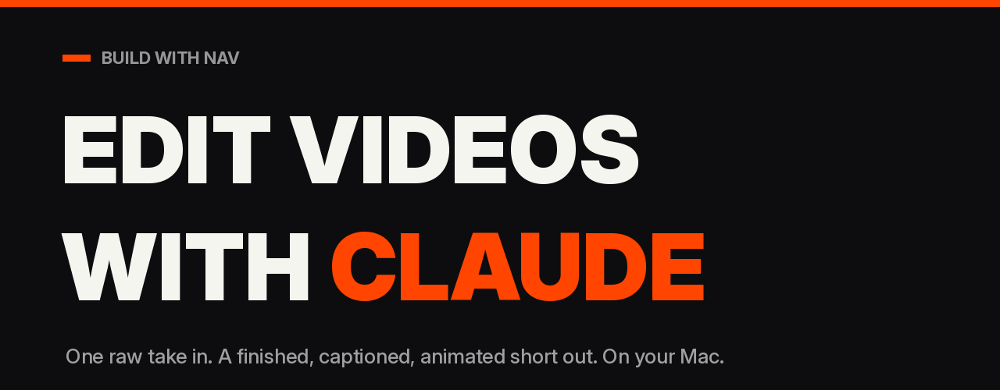

# Edit Videos with Claude


Edit a raw talking-head take into a finished, captioned, motion-graphic short, in your own style, on your Mac. This plugin packages a complete editing pipeline into a skill your assistant can run: local transcription, a cut list you approve, a storyboard made of real frames you approve, then a render with captions, zooms, posters, cards, a film strip of your own footage, an exploded-layers shot, auto sound design and platform loudness. Every graphic is tied to a word you said. Your footage never leaves your laptop.

The launch video was edited entirely by this skill: [buildwithnav.com/edit](https://buildwithnav.com/edit).

Built for creators, not developers. You run one setup command, then you talk to Claude.

## Quick start (Mac, no coding)

1. Open Terminal (press Cmd + Space, type `Terminal`, press Enter), paste this one line, press Enter:

   ```bash
   curl -fsSL https://buildwithnav.com/edit/install | bash
   ```

   It installs everything (about 15 minutes, mostly downloads), then opens a folder called **Claude Video Edits**.
2. Drop your raw recording into the **raw** folder inside it.
3. Double-click **Edit Video.command**. A Terminal window opens with Claude Code running in that folder (Claude Code is the version of Claude that can run the tools on your Mac). Claude asks a couple of questions, shows you the cut list, shows you a storyboard of real frames, and renders after you say go. The finished file lands in **renders**.

That is the whole loop. Add 5 to 10 of your own videos to **references** the first time so it learns your style instead of using mine.


### What the installer puts on your Mac, and why

Homebrew (the standard Mac package manager, if missing), ffmpeg (the open-source video engine), Claude Code (if missing; you sign in with your own Claude account), a Python environment in `~/.claude-video` with faster-whisper (speech to word timings, on your Mac), a person-matte model (finds you in the frame) and headless Chromium (draws the graphics), this skill in `~/edit-videos-with-claude`, and your `Claude Video Edits` folder. About 2GB of downloads. It never uploads footage, creates no accounts and changes no system settings. To remove everything: delete `~/edit-videos-with-claude`, `~/.claude-video`, `~/.claude/skills/edit-video` and `Claude Video Edits`.

## What it produces

A 9:16 (or any format) short that:
- opens with a hook on frame one and "switches on" from a raw look to the edited look;
- has every dead-air gap, um and retake cut, with the last clean take kept;
- is reframed from landscape to vertical by following your head, with no wobble;
- carries mixed-typography captions: bold sans, with the one word that matters in italic serif accent;
- gives every spoken claim a prop: profile card with a red X, giant extruded word behind your head, film strip of your real frames with a frame counter, the edit coming apart into labelled layers, a cut timeline with the removed takes in red, your own videos fanning out as phones, a silhouette moment, posters, chips, a comment-box outro with reactions;
- has sound design on every beat (sparingly: one whoosh per ten seconds) and is normalised to -14 LUFS for the platforms;
- is rendered on your Mac as an H.265 file ready to post. Music gets added on the platform.

## Install by hand (if you'd rather see the files)

```bash
git clone https://github.com/navinramharak-rgb/edit-videos-with-claude.git ~/edit-videos-with-claude
cd ~/edit-videos-with-claude
bash setup.sh
```

Requirements: Apple Silicon Mac on macOS 15 or newer, and a Claude subscription that includes Claude Code (Pro or Max). The installer puts in Homebrew, ffmpeg, a Python environment (local Whisper, the person-matte model, headless Chromium), Claude Code itself, registers the skill so `/edit-video` works, creates the **Claude Video Edits** folder with the **Edit Video** launcher, and ends with a smoke-test video. Re-run it any time; it skips what is done.

To check your machine without installing anything: `bash doctor.sh`. It prints the exact fix for anything missing.

Already use Claude Code or the Claude desktop app? You can also install this as a plugin (open `edit-videos-with-claude.plugin`, or the marketplace commands below). The Mac setup is still needed once, because rendering happens on your machine.

## How to use it

Drop a raw take in `raw/` and ask:

> "Edit this video. It's for Instagram, the CTA is comment EDIT."

The assistant will:
1. run the doctor and ask at most three questions (where the file is, the format, what the video is for);
2. learn your style once from 5 to 10 of your own videos in `references/` and write `style/STYLE.md` and a preset (or use the included `nav-signature` preset if you say so);
3. transcribe locally, propose the cuts, and show you the cut list for approval;
4. plan a prop for every line, with every graphic timed to a spoken word;
5. render a storyboard of real frames and wait for your "go";
6. render, mix, QA a contact sheet of every beat, and tell you what it checked and what is still imperfect;
7. append your corrections to your style file so the next video starts there.

Optional: drop real sound effects into `skills/edit-video/assets/sfx/` named `whoosh`, `hit`, `pop`, `stamp`, `type`, `tick` (.wav or .mp3). Without them a quiet synthesized set is used.

## Changing the style

Everything visual is a preset: accent colour, fonts, caption style, pace, which props are allowed, and a `never` list. Tell the assistant what you'd change ("captions bigger, no posters, blue accent") and it edits the preset and `style/STYLE.md`. My own look ships as `presets/nav-signature.json`, and the complete plan for the launch video is in `examples/plan-edit1.json` so you can see how every beat was built.

## What is inside

```
edit-videos-with-claude/
  .claude-plugin/
    plugin.json                   plugin manifest
    marketplace.json              makes the repo one-click installable
  skills/edit-video/
    SKILL.md                      how the assistant edits: interview, cut-list gate, storyboard gate, render, QA
    edit.sh                       pipeline runner: prep | reframe | cut | matte | board | render | mix
    scripts/                      transcribe, propose_cuts, cut, track, reframe, matte, overlay (HTML + GSAP graphics),
                                  render_plan (camera, grade, captions, compositing), sfx_plan, storyboard, mix
    presets/nav-signature.json    the default look
    examples/plan-edit1.json      the full plan for the launch video
    reference/plan-schema.md      every element and field
    templates/STYLE.md            the style file the skill fills in for you
    assets/fonts, assets/vendor   bundled open-source fonts (OFL) and GSAP
    setup/setup-mac.sh            the installer
    setup/doctor.sh               the dependency check
  setup.sh, doctor.sh             shortcuts to the two scripts above
  LICENSE                         MIT
  CHANGELOG.md                    version history
  README.md                       this file
```

## Share it with others

1. **Send the folder or the zip.** Anyone with a Mac runs `bash setup.sh`.
2. **Marketplace install** for the skill instructions (rendering still needs the Mac setup):

   ```
   /plugin marketplace add navinramharak-rgb/edit-videos-with-claude
   /plugin install edit-videos-with-claude@build-with-nav
   ```

## Philosophy

- **Every line gets a prop.** Not a caption, a prop: a card, a word, a strip, a layer view, a real screenshot. Information gets followers; a prop that literalises the claim gets rewatches.
- **Two approvals, no surprises.** You see the cut list before anything is cut and a storyboard of real frames before anything renders. It edits with you, not instead of you.
- **Proof over decoration.** Real screenshots, the real cut list, your real frames. It never invents results, numbers or testimonials.
- **Your style, not a template.** It learns from your videos and saves every correction, so video two starts where video one ended.
- **Local by default.** Transcription, matting and rendering happen on your Mac. No upload, no credits, no extra services.

## Costs

Your Claude subscription covers the planning and QA (roughly 20 to 40 minutes of Claude time per 60-second video once your style is set). Your Mac does the rendering. Nothing else is required.

## License

MIT. Free to use, modify and share, including commercially. Keep the copyright notice. Fonts are SIL OFL (Inter, Anton, Bebas Neue, Instrument Serif) and Bitstream Vera (DejaVu Sans Mono). GSAP ships under the GreenSock standard "no charge" license. The whisper and matting models download on setup under their own licenses.

## Credit

Made by Build With Nav. Get the newsletter and every update to this skill at [buildwithnav.com/edit](https://buildwithnav.com/edit).
